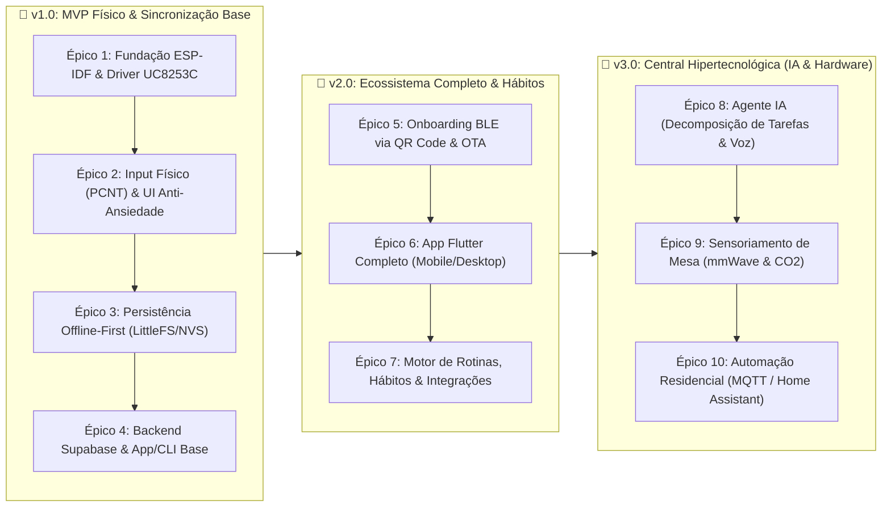

# 🗂️ Product Backlog & User Stories — focOS — The Ambient Desk E-Paper OS (Open Source)

> Este documento estrutura todo o backlog do projeto em **Milestones (v1, v2 e v3)**, **Épicos** e **User Stories (Issues)**, formatado para importação direta no **GitHub Projects / Issues**.

---

## 🏷️ Padrão de Labels Sugerido para o GitHub

| Categoria | Labels Sugeridas |
| :--- | :--- |
| **Camada / Escopo** | `scope:firmware-idf`, `scope:epaper-driver`, `scope:ui-lvgl`, `scope:backend-supabase`, `scope:app-flutter`, `scope:hardware-3d` |
| **Versão (Milestone)** | `milestone:v1-mvp`, `milestone:v2-ecosystem`, `milestone:v3-ai-hub` |
| **Prioridade** | `priority:critical`, `priority:high`, `priority:medium`, `priority:low` |
| **Tamanho / Esforço** | `size:S` (1-2 pts), `size:M` (3-5 pts), `size:L` (8 pts) |

---

## 📊 Visão Geral da Evolução (Roadmap de Releases)

---

# 🚀 MILESTONE v1.0 — MVP de Mesa Funcional (Detalhamento Completo)

> **Meta da v1.0:** Ter o dispositivo físico na mesa rodando em **ESP-IDF nativo**, exibindo as tarefas do dia no display **WeAct 3.7" E-Paper**, permitindo navegar e concluir tarefas com o **Rotary Encoder**, mantendo os dados salvos localmente se a internet cair e sincronizando com o **Supabase**.

---

## 📦 ÉPICO 1: Fundação ESP-IDF & Driver E-Paper (`UC8253C`)

### `US-101` — Estrutura Base do Projeto em ESP-IDF v5.x e Configuração via Kconfig
* **Labels:** `scope:firmware-idf`, `milestone:v1-mvp`, `priority:critical`, `size:S`
* **História:**
  > *Como* desenvolvedor/usuário da comunidade Open Source,
  > *Quero* que o projeto tenha uma arquitetura modular em ESP-IDF v5.x com pinagem configurável via `menuconfig`,
  > *Para que* eu possa compilar o firmware tanto no ESP32 clássico (30 pinos) quanto no ESP32-S3 sem alterar código-fonte.
* **Critérios de Aceite:**
  - [ ] Projeto compila sem warnings no ESP-IDF v5.2+ para os targets `esp32` e `esp32s3`.
  - [ ] Menu `focOS Configuration` visível no `idf.py menuconfig` contendo todos os GPIOs do SPI (MOSI, CLK, CS, DC, RES, BUSY) e do Rotary Encoder (CLK, DT, SW).
  - [ ] Pinagem padrão pré-configurada evitando `GPIO 16` e `GPIO 17` (compatibilidade com PSRAM).
  - [ ] Loop principal de eventos (`esp_event_loop_create_default`) inicializado e documentado.
* **Tarefas Técnicas:**
  1. Criar `CMakeLists.txt` raiz e estrutura de pasta `components/`.
  2. Criar arquivo `main/Kconfig.projbuild` com valores default para ESP32 e ESP32-S3.
  3. Configurar `sdkconfig.defaults` (FreeRTOS tick rate em 1000Hz, partição customizada `partitions.csv`).

---

### `US-102` — Driver Nativo SPI DMA para Display WeAct 3.7" (`UC8253C`) com Proteção Elétrica
* **Labels:** `scope:epaper-driver`, `milestone:v1-mvp`, `priority:critical`, `size:L`
* **Depende de:** `US-101`
* **História:**
  > *Como* usuário com o display sempre ligado na mesa,
  > *Quero* que a tela atualize de forma rápida nas interações (~0.3s) e limpe resíduos automaticamente, desligando a alta tensão após cada uso,
  > *Para que* a resposta seja imediata sem manchar ou queimar o painel E-Paper ao longo dos meses.
* **Critérios de Aceite:**
  - [ ] Barramento SPI inicializado com suporte a DMA (`SPI_DMA_CH_AUTO`).
  - [ ] Função de **Full Refresh** (~2.5s) limpa totalmente a tela sem ghosting.
  - [ ] Função de **Fast Partial Refresh** (~0.3s) atualiza apenas regiões ou o buffer completo sem piscar a tela em preto/branco.
  - [ ] Contador interno executa automaticamente 1 *Full Refresh* a cada 10 *Partial Refreshes* consecutivos.
  - [ ] O comando `POWER_OFF (0x02)` é obrigatoriamente enviado ao `UC8253C` após cada atualização (aguardando o pino `BUSY` liberar), garantindo consumo estático `< 0.01 µA`.
* **Tarefas Técnicas:**
  1. Criar componente `components/epd_uc8253c`.
  2. Implementar sequência de boot, tabelas LUT (Look-Up Tables) de refresh parcial e total para resolução `240x416` (orientação paisagem `416x240`).
  3. Implementar leitura não-bloqueante do pino `BUSY` via semáforo FreeRTOS (evitando `vTaskDelay` cego que trava a CPU).

---

### `US-103` — Integração Gráfica com LVGL em Modo Monocromático (1-bit)
* **Labels:** `scope:ui-lvgl`, `scope:epaper-driver`, `milestone:v1-mvp`, `priority:high`, `size:M`
* **Depende de:** `US-102`
* **História:**
  > *Como* usuário,
  > *Quero* uma tipografia nítida de alto contraste com suporte a acentuação em português (UTF-8),
  > *Para que* eu consiga ler minhas tarefas de relance a 1 metro de distância na minha mesa.
* **Critérios de Aceite:**
  - [ ] LVGL configurado com framebuffer monocromático de 1-bit (`12.480 bytes` para `416x240`).
  - [ ] Fontes customizadas com glifos em Português (`á, é, í, ó, ú, ã, õ, ç`) geradas em 3 tamanhos: Pequena (14px - rodapé/status), Média (18px - lista de tarefas) e Gigante (28px - Modo Hiperfoco).
  - [ ] Rotação de software configurada para modo paisagem (`416px` largura x `240px` altura).
  - [ ] *Flush callback* do LVGL integrado ao driver `epd_uc8253c` com debounce de renderização (agrupa mudanças de UI em um único refresh de tela).
* **Tarefas Técnicas:**
  1. Adicionar LVGL via `idf_component.yml` (ESP Component Registry).
  2. Converter fontes (ex: *Inter* ou *JetBrains Mono* em alto contraste sem anti-aliasing borrado) para formato C do LVGL.
  3. Implementar task dedicada do LVGL com mutex thread-safe.

---

## 📦 ÉPICO 2: Interação Física & Telas Anti-Desorganização

### `US-104` — Leitura do Rotary Encoder via Hardware (`PCNT`) e Máquina de Cliques
* **Labels:** `scope:firmware-idf`, `milestone:v1-mvp`, `priority:critical`, `size:M`
* **Depende de:** `US-101`
* **História:**
  > *Como* usuário interagindo fisicamente com o dispositivo,
  > *Quero* que cada giro do knob e cada clique (curto, duplo ou longo) seja reconhecido com precisão absoluta,
  > *Para que* marcar uma tarefa seja tátil, imediato e livre de falhas ou saltos de cursor.
* **Critérios de Aceite:**
  - [ ] Periférico `PCNT` (Pulse Counter) do ESP32 configurado com filtro de glitch em hardware (`1000 ns`).
  - [ ] Giro horário emite `INPUT_EVENT_ENC_NEXT` e anti-horário emite `INPUT_EVENT_ENC_PREV` no `esp_event_loop`.
  - [ ] Botão `SW` do encoder distingue 3 ações:
    1. **Clique Curto** (`< 400ms` sem segundo clique): `INPUT_EVENT_CLICK_SINGLE`
    2. **Clique Duplo** (2 cliques em `< 350ms`): `INPUT_EVENT_CLICK_DOUBLE`
    3. **Clique Longo** (segurar por `>= 1200ms`): `INPUT_EVENT_CLICK_LONG`
* **Tarefas Técnicas:**
  1. Criar componente `components/input_encoder` usando driver `driver/pulse_cnt.h` do ESP-IDF v5.
  2. Implementar máquina de estados finita (FSM) via `esp_timer` para o botão com debounce de 20ms.

---

### `US-105` — Tela 1: "Lista de Foco do Dia" (Regra das 4 Tarefas Visíveis)
* **Labels:** `scope:ui-lvgl`, `milestone:v1-mvp`, `priority:critical`, `size:M`
* **Depende de:** `US-103`, `US-104`
* **História:**
  > *Como* uma pessoa desorganizada que trava diante de listas gigantes,
  > *Quero* ver uma tela limpa mostrando o progresso do meu dia e no máximo 4 tarefas por vez com destaque claro na tarefa selecionada,
  > *Para que* eu saiba exatamente o que fazer agora sem sentir sobrecarga visual.
* **Critérios de Aceite:**
  - [ ] **Cabeçalho (Header):** Exibe Data atual (ex: `Seg, 02 Nov`), ícone de status Wi-Fi/Sync e uma barra de progresso horizontal com fração concluída (ex: `2/5 concluídas`).
  - [ ] **Corpo (Lista):** Exibe até 4 tarefas simultaneamente (com indicador de rolagem `▲/▼` caso existam mais).
  - [ ] **Cursor:** Ao girar o encoder, uma borda preta sólida ou inversão de cor destaca a tarefa sob o cursor.
  - [ ] **Ação de Check:** Ao dar **1 Clique Curto**, o checkbox muda de `[ ]` para `[✓]`, o texto recebe um risco central (*strikethrough*) e a barra de progresso avança em `~0.3s`.
  - [ ] **Estado Vazio / Dia Concluído:** Quando todas as tarefas do dia são concluídas, exibe tela de recompensa visual (*"Dia dominado! Tudo concluído."*).

---

### `US-106` — Tela 2: "Modo Hiperfoco" (Uma Única Coisa por Vez)
* **Labels:** `scope:ui-lvgl`, `milestone:v1-mvp`, `priority:high`, `size:M`
* **Depende de:** `US-105`
* **História:**
  > *Como* alguém que se distrai facilmente com outras pendências enquanto tenta executar uma tarefa,
  > *Quero* segurar o botão sobre uma tarefa para isolá-la em tela cheia com um marcador de tempo de 25 minutos,
  > *Para que* eu elimine todo o resto do meu campo de visão até terminar aquela única tarefa.
* **Critérios de Aceite:**
  - [ ] Segurar o botão (**Clique Longo**) em uma tarefa pendente na Tela 1 abre o **Modo Hiperfoco**.
  - [ ] A tela limpa todas as outras tarefas e exibe apenas o título da tarefa escolhida em fonte grande centralizada.
  - [ ] Exibe barra de foco de 25 minutos que **atualiza apenas de 1 em 1 minuto** (respeitando o limite físico do E-Paper).
  - [ ] **1 Clique Curto** marca a tarefa como concluída e retorna para a lista principal.
  - [ ] **Duplo Clique** sai do Modo Hiperfoco mantendo a tarefa pendente.

---

## 📦 ÉPICO 3: Armazenamento Local (Offline-First) & Relógio Real

### `US-107` — Persistência Local em LittleFS e Fila de Sincronização (*Outbox*)
* **Labels:** `scope:firmware-idf`, `milestone:v1-mvp`, `priority:high`, `size:M`
* **Depende de:** `US-101`
* **História:**
  > *Como* usuário do display de mesa,
  > *Quero* que minhas tarefas continuem na tela se o ESP32 reiniciar ou se o Wi-Fi cair, e que meus checks físicos nunca sejam perdidos,
  > *Para que* o dispositivo seja 100% confiável como um papel físico.
* **Critérios de Aceite:**
  - [ ] Partição `storage` montada com **LittleFS**.
  - [ ] Arquivo `/littlefs/tasks_cache.json` armazena a lista atual de tarefas. No boot do ESP32, a tela é desenhada em `< 1 segundo` a partir do cache local antes mesmo do Wi-Fi conectar!
  - [ ] Ao concluir uma tarefa sem internet, a mutação (`task_id`, `is_completed`, `updated_at_utc`) é salva em `/littlefs/outbox_queue.json`.
  - [ ] Assim que o Wi-Fi reconecta, a fila `outbox_queue.json` é despachada automaticamente para o servidor.

---

### `US-108` — Sincronização de Horário via SNTP, Virada do Dia e Limpeza Noturna Anti-Burn-in
* **Labels:** `scope:firmware-idf`, `scope:epaper-driver`, `milestone:v1-mvp`, `priority:medium`, `size:S`
* **Depende de:** `US-102`
* **História:**
  > *Como* usuário construindo uma rotina diária,
  > *Quero* que o dispositivo saiba a hora e data corretas para virar a lista à meia-noite e fazer manutenção preventiva da tela de madrugada,
  > *Para que* toda manhã minha lista do dia novo já esteja pronta esperando por mim.
* **Critérios de Aceite:**
  - [ ] Sincronização via `esp_netif_sntp` com `pool.ntp.org` e suporte a fuso horário POSIX configurável (padrão `<-03>3` Brasília).
  - [ ] Às `00:00` locais, dispara evento `EVENT_NEW_DAY` para atualizar o cabeçalho da data e recarregar as tarefas do novo dia.
  - [ ] Às `03:00` da manhã, executa rotina de **Nightly Screen Care** (ciclo completo de inversão preto/branco + *Full Refresh*) para evitar retenção permanente de imagem na tinta eletrônica.

---

## 📦 ÉPICO 4: Backend Supabase & Sincronização em Tempo Real (MVP)

### `US-109` — Schema de Banco de Dados no Supabase (PostgreSQL + RLS + Realtime)
* **Labels:** `scope:backend-supabase`, `milestone:v1-mvp`, `priority:critical`, `size:M`
* **História:**
  > *Como* mantenedor do projeto Open Source,
  > *Quero* um script SQL único (`supabase/migrations/001_init.sql`) que crie todas as tabelas, políticas de segurança e canais Realtime,
  > *Para que* qualquer pessoa consiga subir seu próprio banco em 2 minutos.
* **Critérios de Aceite:**
  - [ ] Tabela `tasks` criada com campos: `id (uuid)`, `title (text)`, `is_completed (bool)`, `priority (smallint)`, `scheduled_date (date)`, `sort_order (int)`, `completed_at (timestamptz)`, `updated_at (timestamptz)`.
  - [ ] Trigger automático atualizando `updated_at = now()` em todo `UPDATE`.
  - [ ] Publicação **Supabase Realtime** habilitada para a tabela `tasks`.
  - [ ] Documentação de como obter `SUPABASE_URL` e `SUPABASE_KEY` no README.

---

### `US-110` — Cliente de Sincronização Bidirecional no ESP-IDF (HTTPS REST + WebSocket Realtime)
* **Labels:** `scope:firmware-idf`, `scope:backend-supabase`, `milestone:v1-mvp`, `priority:critical`, `size:L`
* **Depende de:** `US-107`, `US-109`
* **História:**
  > *Como* usuário,
  > *Quero* que uma tarefa criada no celular/PC apareça na minha tela E-Paper em menos de 1 segundo, e que o check dado no botão físico atualize o banco imediatamente,
  > *Para que* meu mundo físico e digital estejam sempre em perfeita sintonia.
* **Critérios de Aceite:**
  - [ ] Componente `sync_provider` faz `GET /rest/v1/tasks` via HTTPS (`esp_crt_bundle_attach` para TLS seguro sem precisar baixar certificados manualmente).
  - [ ] Conecta ao canal WebSocket do Supabase Realtime (`wss://<project>.supabase.co/realtime/v1/websocket`) escutando `INSERT`, `UPDATE` e `DELETE` na tabela `tasks`.
  - [ ] Quando o usuário dá check no encoder, envia `PATCH /rest/v1/tasks?id=eq.<uuid>` em background sem travar a interface gráfica.
  - [ ] Reconexão automática com *Exponential Backoff* caso o Wi-Fi oscile.

---

### `US-111` — Web App / App Flutter Minimalista (v1) para Cadastro Rápido de Tarefas
* **Labels:** `scope:app-flutter`, `milestone:v1-mvp`, `priority:high`, `size:M`
* **Depende de:** `US-109`
* **História:**
  > *Como* usuário da v1,
  > *Quero* uma tela simples no celular e no navegador do PC para digitar tarefas do dia, reordenar prioridades e ver o que já concluí na mesa,
  > *Para que* eu possa alimentar meu display físico em poucos segundos.
* **Critérios de Aceite:**
  - [ ] Projeto Flutter inicializado em `app/` conectado ao `supabase_flutter`.
  - [ ] Campo de entrada rápida ("Adicionar tarefa para hoje... + Enter").
  - [ ] Lista em tempo real sincronizada com o E-Paper (quando você clica no knob na mesa, o item risca na tela do celular ao vivo).
  - [ ] Filtro simples: *Hoje*, *Pendentes* e *Concluídas*.

---

# 📱 MILESTONE v2.0 — Ecossistema Completo, Rotinas & Open Source Plug-and-Play (Conceitual)

> **Meta da v2.0:** Transformar o projeto em um produto de comunidade onde ninguém precisa editar código para configurar Wi-Fi, introduzindo o **Tracker de Hábitos** para construção de rotina real e integrações externas.

## 📦 ÉPICO 5: Experiência Plug-and-Play (Onboarding & OTA)
* **`US-201` — Provisionamento de Wi-Fi e Supabase via QR Code na Tela E-Paper + BLE:**
  * No primeiro boot sem configuração, o ESP32 gera um QR Code dinâmico no E-Paper. O usuário abre o app Flutter, escaneia a tela e o app envia o SSID, Senha e credenciais do Supabase via Bluetooth Low Energy (BLE) direto para a partição criptografada NVS.
* **`US-202` — Atualização de Firmware Over-The-Air (`esp_https_ota`):**
  * Verificar novas releases no GitHub e atualizar o ESP32 pela rede com partição dupla (`ota_0` / `ota_1`) e rollback automático em caso de falha.

## 📦 ÉPICO 6: Motor de Construção de Rotina & Hábitos
* **`US-203` — Tela 3 no Display: Rastreador de Hábitos Diários (Habit Tracker & Streaks):**
  * Ao dar duplo clique no encoder, alterna para a tela de Hábitos Fixos (ex: *Tomar remédio*, *Beber 2L água*, *30m Exercício*, *Planejar amanhã*), exibindo a sequência de dias seguidos (*Streak* 🔥) para reforço comportamental positivo.
* **`US-204` — Modo "Ritual Matinal" e "Ritual de Encerramento do Dia":**
  * Às 08:00h, se você ainda não escolheu suas 3 prioridades do dia, a tela mostra um convite visual de triagem. Às 21:00h, mostra o resumo do que foi vencido no dia e transfere pendências para o dia seguinte com 1 clique.

## 📦 ÉPICO 7: App Flutter Avançado & Pontes de Integração
* **`US-205` — Widgets Nativos de Celular (iOS/Android) e Quick-Add no Desktop (macOS/Windows):**
  * Atalho global de teclado no computador (`Cmd+Shift+Espaço`) e widget na tela de bloqueio do celular para lançar tarefas na tela E-Paper em 2 segundos.
* **`US-206` — Sincronização Bidirecional com Google Tasks / Todoist / Google Calendar:**
  * Supabase Edge Functions que puxam compromissos da agenda e tarefas externas para dentro do ecossistema `focOS`.

---

# 🧠 MILESTONE v3.0 — A Central Hipertecnológica: IA, Voz & Sensores (Conceitual)

> **Meta da v3.0:** Usar inteligência artificial generativa, comando de voz e sensores físicos na mesa (migrando ou expandindo para o **ESP32-S3**) para reduzir a zero o esforço mental de se organizar.

## 📦 ÉPICO 8: Copiloto de IA contra Paralisia Executiva
* **`US-301` — "Goblin Mode / Quebrador de Tarefas com IA" (Gemini API + Supabase Edge Functions):**
  * Pessoas desorganizadas travam porque anotam tarefas grandes e vagas (ex: *"Resolver mudança"* ou *"Estudar para prova"*). Com 1 botão no app ou segurando o knob, o agente IA quebra a tarefa monstruosa em **4 micro-passos ridiculamente fáceis de 10 minutos** e envia para o E-Paper um por vez.
* **`US-302` — Captura de "Brain Dump" por Voz (Áudio no App ou Microfone I2S no ESP32-S3):**
  * Você fala por 30 segundos tudo o que está bagunçado na sua cabeça: *"Preciso ligar pro contador, comprar ração até sexta e revisar o PR do João hoje à tarde"*. A IA transcreve, extrai as 3 tarefas, define as datas/prioridades e já desenha na sua tela E-Paper.
* **`US-303` — Triagem Matinal Inteligente (Auto-Agendamento):**
  * Baseado no seu histórico de quais horários você rende mais, a IA sugere automaticamente as 3 tarefas ideais para começar o dia.

## 📦 ÉPICO 9: Sensoriamento Ambiental e de Presença na Mesa
* **`US-304` — Sensor de Presença Humana por Radar `mmWave` (LD2410):**
  * Detecta quando você senta na cadeira da mesa pela primeira vez no dia (mesmo se ficar imóvel lendo). Aciona um boas-vindas sutil ou avisa caso você esteja sentado há 40 minutos sem nenhuma tarefa selecionada em Modo Hiperfoco.
* **`US-305` — Monitor Cognitivo de Qualidade do Ar ($\text{CO}_2$ / Temperatura com SCD40):**
  * Níveis de $\text{CO}_2 > 1200\text{ ppm}$ no quarto fechado causam fadiga mental, bocejos e perda drástica de foco. O display exibe um alerta discreto no rodapé: *"Ar pesado (1400ppm CO2) — Abra a janela para recuperar o foco"*.

## 📦 ÉPICO 10: Domótica & Case Física Customizada
* **`US-306` — Adaptador MQTT Nativo com Home Assistant Auto-Discovery:**
  * Ao entrar em *Modo Hiperfoco* na tela E-Paper, o ESP32 publica um evento MQTT que muda a iluminação do seu quarto para "Modo Concentração", silencia notificações e avisa na porta que você está focado.
* **`US-307` — Case Impressa em 3D Open Source (Arquivos `.STL` / `.STEP` + Suporte a Bateria LiPo):**
  * Modelagem paramétrica em Fusion360/OpenSCAD com inclinação ergonômica de $65^\circ$ na mesa, encaixe para o módulo WeAct 3.7", Knob de alumínio usinado e circuito de carga de bateria com medição de tensão via ADC.

---

## 🛠️ Ordem de Execução Recomendada para a `v1.0` (Primeira Sprint)

Para começar a codificar e já ver a tela funcionando na sua bancada o quanto antes, a sequência ideal de Issues é:

1. **`US-101`** (Setup ESP-IDF + Kconfig)
2. **`US-102`** (Driver WeAct 3.7" `UC8253C` fazendo Full e Partial Refresh)
3. **`US-103`** (LVGL desenhando texto nítido na tela)
4. **`US-104`** (Rotary Encoder funcionando com `PCNT`)
5. **`US-105` & `US-106`** (Telas da Lista do Dia e Modo Hiperfoco navegáveis na mesa com dados mockados)
6. **`US-107` & `US-108`** (Salvando no LittleFS da Flash + Relógio NTP)
7. **`US-109`, `US-110` & `US-111`** (Conectando ao Supabase + App Flutter)

