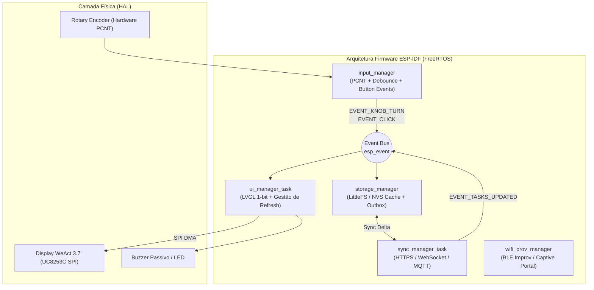
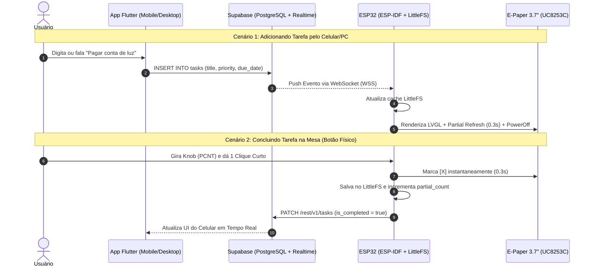
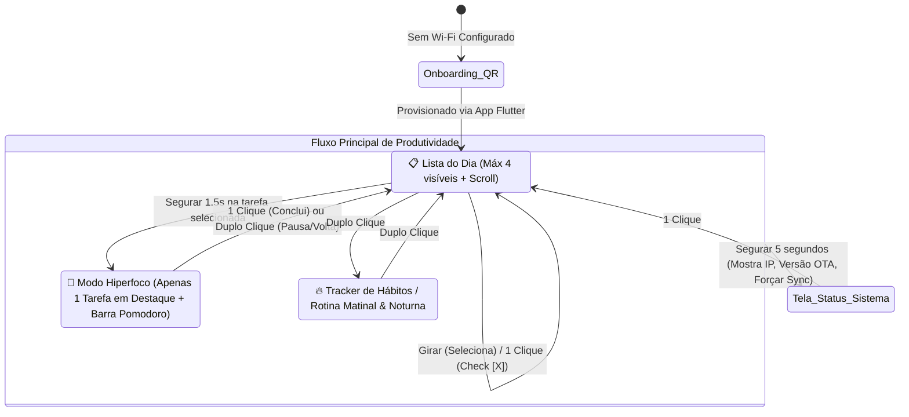

# 📋 Blueprint Arquitetural & Revisão Crítica: focOS — The Ambient E-Paper Desk OS (Open Source)

> **Objetivo:** Criar um ecossistema físico e digital *Open Source* para combater a desorganização crônica e a disfunção executiva (TDAH/falta de rotina), unindo um display de tinta eletrônica (E-Paper) na mesa de trabalho a uma arquitetura moderna, escalável e extensível em ESP-IDF, Flutter e Supabase.

---


## 0. O Manifesto focOS: Filosofia de um "Desk OS" de Baixo Atrito

O **focOS** nasce não como um código monolítico de tarefas, mas como a semente de um **Sistema Operacional de Mesa** (*Ambient Desk OS*) guiado por 4 pilares:

1. **Arquitetura Modular de Apps (Micro-Kernel & Lifecycle):**
   * O sistema roda um núcleo com **FreeRTOS** (`esp_event`, gerenciamento de energia, Wi-Fi e HAL de display).
   * Telas são concebidas como **aplicativos independentes** que implementam a interface `focos_app_t` (`on_init`, `on_draw`, `on_event`, `on_destroy`). Na v1, os dois primeiros apps nativos são: **Task Manager** e **Hiperfoco**.
2. **Camada de Abstração de Hardware (HAL):**
   * Nenhum app acessa diretamente os pinos do SPI ou o driver do `UC8253C`. Todos consomem o `focos_display_service`, permitindo que o `focOS` rode amanhã em telas de 3.7", 4.2", 7.5" ou coloridas sem alterar uma linha de lógica dos apps.
3. **Calm Technology (Anti-Ansiedade & Estética Passiva):**
   * Um sistema operacional de mesa deve ser como um relógio de parede ou um quadro: silencioso, paciente, sem notificações agressivas, sem luz emitida e focado em combater a sobrecarga cognitiva.
4. **Visão de Longo Prazo (v4 / v5 — Dynamic App Engine & WASM):**
   * Nas versões futuras, o `focOS` integrará um runtime leve (WebAssembly / WAMR ou Lua) para que a comunidade possa baixar e rodar mini-widgets/apps no display sem precisar recompilar o firmware em C.

---

## 1. Auditoria Crítica do Plano Inicial (Red Teaming: Falhas e Incoerências)

Ao revisar a proposta original sob a ótica de **Sistemas Embarcados (ESP-IDF)**, **Física de Displays E-Paper** e **Psicologia Comportamental**, identificamos 6 falhas críticas que precisam ser corrigidas na arquitetura:

### 1.1. Incoerência do "Cronômetro Pomodoro de Segundo a Segundo" no E-Paper
* **A Falha:** O plano original previa um cronômetro `25:00` atualizando no centro da tela. Tentar atualizar um display E-Paper a cada 1 segundo (1 Hz) com *partial refresh* causará **ghosting severo em menos de 1 minuto**, aquecimento/desgaste prematuro das microcápsulas eletroforéticas do controlador `UC8253C` e consumo desnecessário.
* **A Correção:** O modo Pomodoro no E-Paper deve atualizar **apenas a cada 1 minuto** (ex: `25 min` -> `24 min`) ou por meio de uma **barra de progresso visual discreta** que avança em blocos a cada 1-2 minutos, com um alerta sonoro sutil (buzzer piezoelétrico/vibracall) ou piscar de tela ao final do ciclo.

### 1.2. Incoerência de Ecossistema: `GxEPD2` vs. Requisito Nativo `ESP-IDF`
* **A Falha:** O documento mencionava a biblioteca `GxEPD2`. Porém, a `GxEPD2` é fortemente acoplada ao framework **Arduino** (`Adafruit_GFX`). Usá-la dentro do **ESP-IDF puro** exige *arduino-as-component*, o que traz bloatware, engessa o controle de tasks do FreeRTOS e prejudica a qualidade de um projeto Open Source profissional.
* **A Correção:** No **ESP-IDF nativo**, devemos utilizar **`esp_lcd`** (driver de baixo nível oficial da Espressif) combinado com **LVGL (Light and Versatile Graphics Library)** configurado em 1-bit monocromático (ou `u8g2` / driver customizado para `UC8253C` com suporte a LUTs de *partial refresh*).

### 1.3. Conflito de Pinos no ESP32 (GPIO 16/17 e Strapping Pins)
* **A Falha:** O mapeamento original sugeria `GPIO 5` (CS), `GPIO 16` (RES) e `GPIO 17` (DC).
  * Embora funcione no `ESP32-WROOM-32` básico, se um usuário da comunidade Open Source usar um **ESP32-WROVER** ou **ESP32-S3 com PSRAM Octal**, os pinos `GPIO 16` e `GPIO 17` são usados internamente pela PSRAM/Flash e causarão **Crash (Guru Meditation Error)** no boot.
  * Além disso, `GPIO 5` e `GPIO 4` são *strapping pins* em algumas revisões.
* **A Correção:** Definir um perfil de pinos seguro via `Kconfig` (`idf.py menuconfig`) e usar o periférico **PCNT (Pulse Counter)** em hardware para o Rotary Encoder (evitando perda de passos ou interrupções excessivas de CPU durante transferências SPI).

### 1.4. Armadilha Psicológica: Excesso de Tarefas na Tela (Paralisia de Escolha)
* **A Falha:** Colocar "6 a 8 tarefas + tags + próximo compromisso + barra de progresso" em uma tela de `416 x 240` pixels gera poluição visual e ansiedade para quem está tentando sair da inércia.
* **A Correção (Regra 1-3-5 & Modo "Uma Única Coisa"):**
  * A tela principal exibirá no máximo **3 a 4 tarefas visíveis por vez** com tipografia grande, legível a 1 metro de distância.
  * Criação do **Modo Hiperfoco (Zero Ansiedade):** Com um clique longo no início da tarefa, a tela esconde toda a lista e mostra **APENAS a tarefa atual em fonte gigante**, eliminando a sobrecarga mental do que vem depois.

### 1.5. Dependência de Rede Sem Armazenamento Local (Offline-First)
* **A Falha:** Se o Wi-Fi cair ou o servidor estiver inacessível, o dispositivo não pode travar nem perder o check que o usuário deu na mesa.
* **A Correção:** Implementar persistência local na Flash do ESP32 (**NVS / LittleFS**) com fila de sincronização (*Outbox Queue*). O check físico é salvo localmente em `< 5 ms`, atualiza a tela em `0.3s` e sincroniza em background.

### 1.6. O Paradoxo da "Fase 1 Isolada" vs. Retrabalho na Fase 2
* **A Falha:** Construir um Web Server HTML/CSS completo dentro do C do ESP32 na Fase 1 dará muito trabalho e será jogado fora na Fase 2 quando o app e o banco entrarem.
* **A Correção:** Na Fase 1, o ESP32 expõe apenas uma **API REST JSON local mínima + mDNS (`esplista.local`)** ou já se conecta direto ao **Supabase** desde o Dia 1.

---

## 2. Decisões Arquiteturais e Justificativas Técnicas

### 2.1. Arquitetura do Firmware no ESP32 (`ESP-IDF` Nativo)

Para um projeto Open Source de nível industrial, utilizaremos **ESP-IDF (v5.x)** estruturado em **Componentes Modulares** e orientado a eventos via **`esp_event`** e **FreeRTOS**.



#### Estrutura de Diretórios do Firmware (`ESP-IDF`):
```text
firmware/
├── CMakeLists.txt
├── sdkconfig.defaults
├── main/
│   ├── CMakeLists.txt
│   ├── Kconfig.projbuild       # Pinout e configs customizáveis via menuconfig
│   └── main.c                  # Bootstrapping e inicialização do Event Loop
└── components/
    ├── epd_uc8253c/            # Driver SPI DMA + LUTs de Partial/Full Refresh
    ├── ui_lvgl/                # Telas LVGL monocromáticas (Foco, Lista, Hábitos)
    ├── input_encoder/          # Leitura via periférico PCNT + Máquina de cliques
    ├── task_storage/           # Cache JSON em LittleFS + Fila offline
    ├── sync_provider/          # Interface abstrata (Supabase, MQTT, Local REST)
    └── wifi_onboarding/        # Provisionamento BLE/SoftAP sem hardcode de senha
```

---

### 2.2. Stack do Aplicativo (Mobile, Desktop & Web): **Flutter**

**Decisão:** **Flutter** é a escolha definitiva para o aplicativo companheiro.

**Justificativas Técnicas:**
1. **Código Único Multiplataforma Real:** Como você usará o sistema na sua mesa de trabalho, ter o app apenas no celular é limitante. Com Flutter, o mesmo código compila nativamente para **Android, iOS, macOS, Windows, Linux e Web (PWA)**. Você pode adicionar tarefas pelo atalho no Mac enquanto trabalha ou pelo celular na rua.
2. **Bluetooth Low Energy (BLE) Nativo para Provisionamento:** Como o projeto será Open Source, ninguém quer baixar o código em C para colocar o nome e senha do Wi-Fi de casa. O Flutter possui pacotes maduros (`flutter_reactive_ble` / `esp_provisioning_ble`) para configurar o Wi-Fi do ESP32 pelo celular em 10 segundos.
3. **Widgets de Tela Inicial e Quick Actions:** Facilidade para criar Widgets no Android/iOS e captura rápida de voz/texto sem sequer abrir o app inteiro.

---

### 2.3. Banco de Dados e Backend: **Supabase** vs. Firebase

**Decisão:** **Supabase (PostgreSQL)** vence com ampla vantagem sobre o Firebase.

| Critério | Supabase (Escolhido) | Firebase (Descartado) |
| :--- | :--- | :--- |
| **Filosofia Open Source** | **100% Open Source.** Qualquer usuário pode rodar na nuvem gratuita do Supabase OU rodar localmente via `docker compose` em um Raspberry Pi / servidor caseiro. | **Proprietário (Vendor Lock-in).** Impossível rodar self-hosted fora da nuvem do Google. |
| **Comunicação com ESP32** | Expõe **API REST (PostgREST)** limpa e **WebSockets (Realtime)** leves que o `esp_http_client` do ESP-IDF consome em poucas linhas de C com `cJSON`. | O SDK C++ do Firebase é pesado, não é nativo do ESP-IDF e a API REST do Firestore tem um formato JSON verboso e complexo para parsear em C. |
| **Modelagem de Dados** | **PostgreSQL Relacional.** Ideal para relacionar Tarefas, Subtarefas, Histórico de Hábitos (Streaks), Ciclos de Pomodoro e Logs de Produtividade. | NoSQL orientado a documentos. Consultas analíticas de hábitos e agregações semanais ficam caras e complexas. |
| **Pronto para IA (Fase 3)** | Possui **`pgvector`** nativo e **Edge Functions** (TypeScript) para integrar LLMs (Gemini/OpenAI) sem precisar subir outro servidor. | Exige configurações mais acopladas ao GCP/Vertex. |

---

### 2.4. Precisaremos utilizar **MQTT**?

**Decisão:** **Não como requisito obrigatório para o usuário comum, mas sim como um Adaptador Opcional (Fase 2/3 para usuários de Home Assistant).**

**Justificativas Técnicas:**
1. **O Problema do MQTT para Projetos Open Source de Produtividade:** Se exigirmos MQTT, qualquer pessoa que queira montar o projeto precisará configurar e manter um Broker MQTT (Mosquitto, EMQX, HiveMQ Cloud), gerenciar certificados TLS e criar uma ponte entre o Banco de Dados e o Broker. Isso cria uma barreira de entrada enorme.
2. **Como faremos a sincronização em tempo real sem MQTT?**
   * **Caminho Padrão (Zero InfraExtra):** O ESP32 usa **HTTPS REST + Supabase Realtime (via `esp_websocket_client` sobre TLS)**. Quando você adiciona ou marca uma tarefa no app Flutter, o Supabase envia o evento pelo WebSocket aberto e o ESP32 atualiza o E-Paper em **menos de 500ms**.
3. **Onde o MQTT entra então?**
   * Como desenhamos o componente `sync_provider` no ESP-IDF usando o padrão *Strategy/Adapter*, teremos o `mqtt_ha_adapter` (usando a biblioteca oficial `esp-mqtt` do ESP-IDF). Quem já tem **Home Assistant** em casa poderá ativar o MQTT no menu para que o display apareça automaticamente via *MQTT Discovery* na automação residencial!

---

## 3. Outras Definições Técnicas Essenciais (O que faltava definir)

Para que o projeto seja robusto e **100% Open Source**, precisamos estabelecer estas 6 definições técnicas desde o início:

### 3.1. Provisionamento Zero-Hardcode (Wi-Fi & API Keys)
* **Definição:** Nenhum dado sensível (`SSID`, `Senha Wi-Fi`, `Supabase URL/Key`) ficará no código-fonte.
* **Solução:** Utilizaremos o componente oficial **`wifi_provisioning` da Espressif via BLE** (ou **Improv Wi-Fi** via Serial Web/BLE). No primeiro boot, o E-Paper exibe um **QR Code gerado dinamicamente na própria tela**. O usuário lê o QR Code com o app Flutter e o ESP32 recebe o Wi-Fi e o Token de autenticação automaticamente, salvando tudo criptografado na partição **NVS**.

### 3.2. Sincronização de Tempo Real (SNTP + Fusos Horários POSIX)
* **Definição:** Como saber quando "vira o dia" para resetar os hábitos e mostrar a lista de hoje?
* **Solução:** O ESP32 não tem bateria de relógio (RTC externo) por padrão. Ao conectar no Wi-Fi, o módulo **`esp_netif_sntp`** sincroniza o relógio interno com servidores NTP (`pool.ntp.org`) e aplica a string POSIX de fuso horário (ex: `<-03>3` para Brasília), mantendo a hora exata mesmo em modos de economia de energia (*Light Sleep*).

### 3.3. Estratégia Anti-Ghosting e LUTs Customizadas do `UC8253C`
* **Definição:** Como garantir que a tela WeAct 3.7" dure anos sem manchar?
* **Solução:**
  1. **Contador de Refresh Parcial (`partial_count`):** Toda navegação de cursor ou check de tarefa usa *Fast Partial Update* (~0.3s). Quando `partial_count == 10`, a próxima atualização executa automaticamente um *Full Refresh* (~2.5s) para realinhar todas as cápsulas de tinta.
  2. **Pixel Shifting & Night Clear:** Às 03:00 da manhã, o display faz uma limpeza completa de tela e inverte preto/branco por alguns segundos para evitar retenção de imagem (*burn-in* eletroforético).
  3. **Desligamento de Carga (Power Off Command):** Após cada atualização de tela (parcial ou total), o firmware **obrigatoriamente** envia o comando `POWER_OFF (0x02)` para o controlador `UC8253C`, desenergizando a bomba de carga de alta tensão interna do display (se não fizer isso, as bordas da tela escurecem permanentemente com os meses).

### 3.4. Resolução de Conflitos Offline (Last-Write-Wins com `updated_at`)
* **Definição:** O que acontece se você marcar uma tarefa no botão físico enquanto o Wi-Fi está fora do ar, e editar a mesma tarefa no celular?
* **Solução:** Cada tarefa possui um `UUID v4`, um campo booleano `is_completed`, `completed_at` e `updated_at` (timestamp UTC). O estado é reconciliado por timestamp mais recente.

### 3.5. Atualização de Firmware Remota (OTA - Over-The-Air)
* **Definição:** Depois que o dispositivo estiver fechado em uma case 3D bonita na sua mesa, você não vai querer desmontar tudo para atualizar o cabo USB.
* **Solução:** Esquema de partição **`Dual OTA` (`ota_0` e `ota_1`)** na Flash de 4MB do ESP32. Usando `esp_https_ota`, o dispositivo baixa novas versões diretamente das *Releases* do seu repositório no GitHub!

### 3.6. Padrão de Hardware Seguro (Pinout Oficial para ESP32 e ESP32-S3)

Pinagem exata com a serigrafia da sua placa (**VCC, GND, SDA, SCL, CS, D/C, RES, BUSY**):

| Pino no Display | Função | ESP32 (30 Pinos) | ESP32-S3 | Motivo da Escolha / Segurança |
| :--- | :--- | :--- | :--- | :--- |
| **VCC** | Alimentação 3.3V | `3V3` | `3V3` | **Atenção:** Usar 3.3V, nunca 5V/VIN! |
| **GND** | Terra | `GND` | `GND` | Referência comum |
| **SDA** | Dados SPI (MOSI/SDI) | `GPIO 23` | `GPIO 11` | SPI nativo de alta velocidade |
| **SCL** | Clock SPI (SCLK/CLK) | `GPIO 18` | `GPIO 12` | SPI nativo de alta velocidade |
| **CS** | Chip Select | `GPIO 5` | `GPIO 10` | Habilita comunicação com o display |
| **D/C** | Data / Command | `GPIO 19` | `GPIO 13` | Alterna entre dados e comandos (Livre de PSRAM) |
| **RES** | Reset do Display | `GPIO 21` | `GPIO 14` | Reinicialização em hardware (Livre de PSRAM) |
| **BUSY** | Status de Ocupado | `GPIO 4` | `GPIO 9` | Ativo em nível LOW (0 = Ocupado, 1 = Pronto) |
| **ENC CLK (A)** | Fase A do Knob | `GPIO 32` | `GPIO 4` | Contagem por hardware no periférico `PCNT` |
| **ENC DT (B)** | Fase B do Knob | `GPIO 33` | `GPIO 5` | Contagem por hardware no periférico `PCNT` |
| **ENC SW** | Botão Clique | `GPIO 25` | `GPIO 6` | Suporte a wakeup de economia de energia |

---

## 4. Fluxos de Dados e Experiência de Uso Revisados

### 4.1. Fluxo Completo: Arquitetura Cloud/Local Híbrida (Open Source)



### 4.2. Máquina de Estados de Telas (Focada em Combate à Desorganização)



---

## 5. Roadmap Evolutivo Consolidado

### Fase 1: Fundação Embarcada (`ESP-IDF` + Hardware na Mesa)
1. Setup do projeto **ESP-IDF v5.x** com estrutura modular de componentes.
2. Implementação do driver `epd_uc8253c` (Full Refresh, Partial Refresh e proteção `PowerOff`) integrado ao **LVGL**.
3. Leitura do Rotary Encoder via hardware **PCNT** + detecção de clique simples, duplo e longo.
4. Persistência local de tarefas em JSON via **LittleFS** + tela principal da Lista do Dia e Modo Hiperfoco.

### Fase 2: Conectividade Open Source (`Supabase` + `Flutter`)
1. Criação do schema SQL (Migrations) no **Supabase** (Tabelas: `devices`, `tasks`, `habits`, `focus_sessions`).
2. Implementação do cliente `sync_provider` no ESP-IDF (REST + WebSockets Realtime + SNTP).
3. Desenvolvimento do **App em Flutter** (Mobile/Desktop) com provisionamento de Wi-Fi via BLE/QR Code e CRUD de tarefas em tempo real.

### Fase 3: A Central Hipertecnológica (IA, Voz & Sensores)
1. **Agente IA de Desconstrução de Tarefas (Supabase Edge Functions + Gemini API):** Você digita uma meta vaga ("Organizar imposto de renda") e a IA quebra automaticamente em 4 micro-passos acionáveis de 15 minutos que vão direto para o E-Paper.
2. **Captura por Voz Instantânea:** Botão de voz no app (ou microfone I2S na placa **ESP32-S3**) que transcreve pensamentos soltos em tarefas categorizadas.
3. **Presença & Ambiente:** Sensor de presença **mmWave (LD2410)** na mesa que detecta quando você senta para trabalhar pela manhã e exibe um resumo matinal inteligente, além de sensor de $\text{CO}_2$/temperatura (SCD40) que avisa quando o ar do quarto está deixando você sonolento e sem foco.
4. **Adaptador MQTT / Home Assistant:** Sincronização com luzes da mesa (ex: acender uma luz quente de foco ao entrar no Modo Hiperfoco no display).
